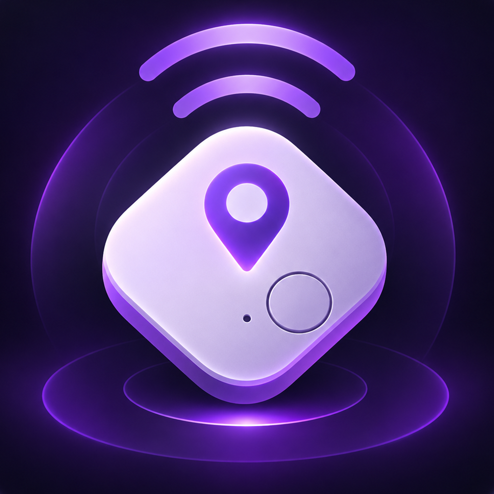

<p align="center">
  
</p>

<h1 align="center">TPCM Find</h1>

<p align="center">
  Ucuz Bluetooth "Anti-Lost" iTag anahtarlıkları için açık kaynak bulucu uygulaması.<br>
  Flutter · Bluetooth Low Energy · Android (iOS hazırlanıyor)
</p>

---

Bu tür anahtarlıklar genelde kutudan çıkan, reklamlı ve gereğinden fazla izin isteyen üçüncü parti uygulamalarla kullanılıyor. TPCM Find bu uygulamaların yerine geçen sade bir alternatif. Hesap açmak gerekmiyor, konum istemiyor, hiçbir veriyi bir sunucuya göndermiyor.

## Uyumlu cihaz

Uygulama, piyasada **"iTag"**, **"Anti-Lost"** ya da **"Bluetooth 4.0 Smart Tracker"** adıyla satılan markasız anahtarlıklar için yazıldı. Bunlar genelde yuvarlak ya da damla şeklinde, üstünde tek tuşu olan, CR2032 pilli, "selfie / voice recording / anti-lost" yazılı kutularda gelen anahtarlıklar.

Geliştirme ve testler bu cihazlardan biriyle yapıldı. Bu cihazlar Bluetooth'ta genelde **`iTAG`** ya da benzeri bir adla görünür. Bir cihazın uyumlu olup olmadığını isminden değil, sunduğu **BLE servislerinden** anlıyoruz. Uygulama ilk bağlantıda bunları kontrol eder:

| Servis | Karakteristik | Uygulamada ne işe yarıyor | Gerekli mi? |
| --- | --- | --- | --- |
| `1802` Immediate Alert | `2A06` Alert Level | Etiketi öttürmek (`0x00` sus, `0x01` hafif, `0x02` yüksek) | **Evet** |
| `FFE0` (üreticiye özel) | `FFE1` | Etiketteki tuşa basıldığını almak | **Evet** |
| `180F` Battery | `2A19` Battery Level | Pil yüzdesini göstermek | Hayır |
| `1803` Link Loss | `2A06` | Varsa etiketin "kopunca ötme" özelliğini kapatmak | Hayır |

- **İlk iki servisi olan** cihazlar iTag olarak tanınır ve tüm özellikler açılır.
- **Diğer BLE cihazlar** "genel Bluetooth cihazı" olarak kaydedilebilir. Bunlarda yalnızca bağlantı ve mesafe gösterimi çalışır.
- **Uyumlu değil:** Apple AirTag, Samsung SmartTag, Tile gibi markalı takipçiler. Bunlar kendi şifreli protokollerini kullanır.

> Not: Test edilen cihazda `1803` servisi yok. Bu yüzden etiket her bağlantı kopuşunda öter ve bu davranış yazılımla kapatılamaz. Uygulamanın etikete yalnızca istendiğinde bağlanmasının sebebi bu.

## Özellikler

- **Bul:** "Bağlan"a basınca Bluetooth açılır, etiket 30 saniyeye kadar aranır ve bulunduğu anda bağlanılır. Bağlantı gecikirse uygulama 3 kez dener.
- **Öttür:** Etiket yüksek sesle öter ve 30 saniye sonra kendiliğinden susar.
- **Tahmini uzaklık:** Sinyal gücünden (RSSI) yaklaşık metre hesaplanır. Etiketi 1 metre uzağa koyup kalibrasyon yaparak tahmin iyileştirilebilir.
- **Tuş bildirimi:** Etiketteki tuşa basınca telefon titrer ve ses çalar.
- **Pil seviyesi:** Etiket destekliyorsa pil yüzdesi gösterilir.
- **İsim ve simge:** Anahtar, cüzdan, araba, çanta gibi simgelerle birden fazla etiket yönetilebilir.
- **Taklit kontrolü:** Kayıtlı bir etiketin kimliğiyle bağlanan cihaz iTag gibi davranmıyorsa bağlantı kesilir.
- **Gizlilik:** Hesap, sunucu ya da konum kaydı yoktur. Tüm veriler telefonda kalır.

**Bilerek yapılmayanlar:** Otomatik bağlanma, arka planda sürekli bağlı kalma ve harita. Bunlar denendi ama bu etiketin her kopuşta ötmesi ve pil tüketimi yüzünden kaldırıldı. Ayrıntılar [teknik raporda](docs/TEKNIK_RAPOR.md#9-denenip-kaldırılanlar).

## Kurulum

### Gereksinimler

- Flutter 3.41+ (Dart 3.11+)
- Android 7.0+ (API 24) telefon, BLE destekli
- iOS: Kod hazır ama henüz derlenip test edilmedi

### Derleme

```bash
flutter pub get

# Geliştirme
flutter run

# Hafif sürüm (yaklaşık 19 MB, 64-bit Android telefonlar)
flutter build apk --release --target-platform android-arm64
adb install -r build/app/outputs/flutter-apk/app-release.apk
```

Uygulama ikonunu değiştirmek için `assets/icon/app_icon.png` dosyasını değiştirip şu komutu çalıştırın:

```bash
dart run flutter_launcher_icons
```

> Release sürümü şimdilik debug anahtarıyla imzalanıyor (`android/app/build.gradle.kts`). Mağazaya yüklemek için kendi keystore'unuzu oluşturun. `key.properties`, `*.jks` ve `*.keystore` dosyaları `.gitignore` ile repo dışında tutulur.

## Proje yapısı

```
lib/
├── main.dart                 Giriş noktası
├── tag_connection.dart       BLE bağlantısı, öttürme, mesafe, iTag doğrulama
├── models.dart               Kayıtlı cihaz modeli ve kalıcı veri
├── permissions.dart          İzinler (Android native köprü)
├── theme.dart                Koyu tema, renkler
├── widgets.dart              Ortak bileşenler
└── screens/                  Ekranlar: karşılama, cihazlarım, keşfet,
                              bağlanma, cihaz detayı, ayarlar
android/app/src/main/kotlin/  MainActivity.kt: izin kanalı
assets/icon/                  Uygulama ikonu
docs/
├── TEKNIK_RAPOR.md           Teknik rapor: mimari, BLE, mesafe, güvenlik, dersler
└── design/                   Arayüz tasarım dokümanı, konsept görsel, ikon kaynağı
```

## Güvenlik notu

Bu tür ucuz etiketlerde **eşleşme (pairing) ve şifreleme yoktur**. Menzildeki herhangi bir telefon herhangi bir iTag uygulamasıyla etikete bağlanıp onu öttürebilir. Etiket MAC adresini sürekli yayınlar. Bu, cihazın donanım sınırıdır ve hiçbir uygulama bunu çözemez. Etikette mikrofon yoktur; kutudaki "voice recording" ifadesi telefon tarafındaki bir uygulama özelliğini anlatır.

Ayrıntılı tehdit modeli için [teknik rapora](docs/TEKNIK_RAPOR.md#7-güvenlik) bakabilirsiniz.

## Dokümanlar

- [Teknik rapor](docs/TEKNIK_RAPOR.md): Mimari, kullanılan teknolojiler, BLE/GATT, mesafe formülü, güvenlik, karşılaşılan hatalar.
- [Arayüz tasarım dokümanı](docs/design/TPCM_Find_UI_UX_Tasarim_Dokumani.md): İlk tasarım. Harita ve kayıp modu gibi bazı bölümleri sonradan kaldırıldı.

---

<p align="center">TPCM Studio</p>
